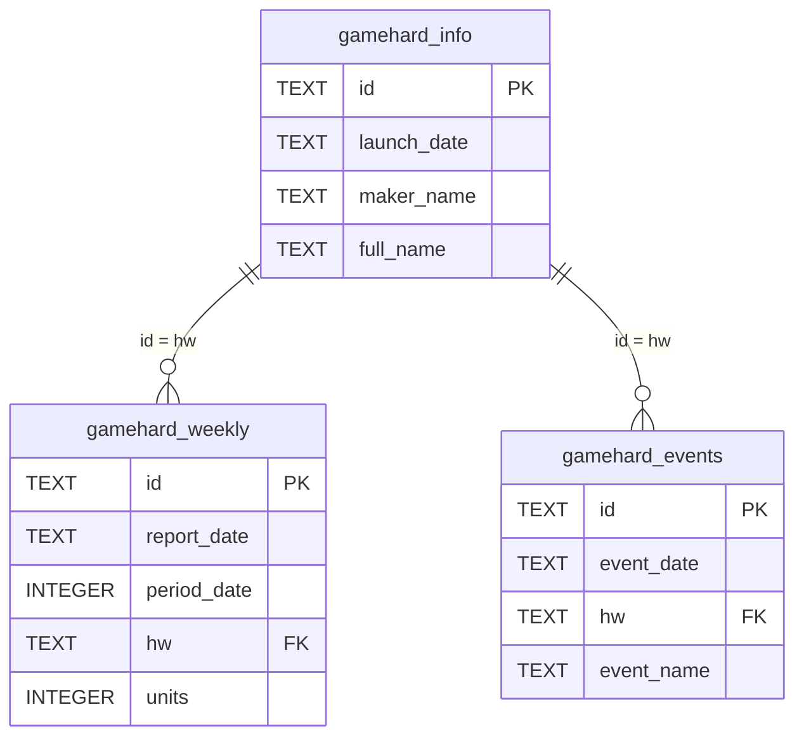

# データベース設計概要

このリポジトリのデータベースは、ゲームハードの情報・週次販売データ・関連イベント情報を
管理するためのSQLite3用スキーマです。  
本READMEでは、`create_tables.sql` で定義されているテーブル構造と
その設計意図について説明します。

---
## データベース初期化

### 新規データベースの作成と初期データの投入

init_database.sh を実行することで、SQLite3データベースファイルが作成され、テーブルが初期化されます。
init_database.shは以下の処理を行います｡

1. データベースファイルを作成する
2. create_tables.sql を実行してテーブルを作成する
3. update_tables.sql を実行して販売台数の補正列を追加する
4. hard_info.csv の内容を gamehard_info テーブルに投入する
5. ../data_source/hard_weekly_init.csv の内容を gamehard_weekly テーブルに投入する

### ファミ通データの更新(毎週)

以下の手順で毎週更新を行います｡

```bash
$ cd update/
$ ./famitsu.py <ファミ通のハードセールスURL>  # データに間違いがないか確認する｡
$ ./famitsu.py -c <ファミ通のハードセールスURL> # データベースを更新する｡
$ ./famitsu.py -l <保存ファイル名> <ファミ通のハードセールスURL> # URLと取得元テキストを保存する｡
```

### 手動による更新

1. 更新データを含むCSVファイルを用意する（例: `weekly_update.csv`）。
2. `csvupdate.py -c <csvファイルのパス>` を実行して、データベースを更新する。

デフォルトでは同じ行に対する更新はできません｡(データ破壊防止のため)
同じ行に対しUPDATEを行う場合には `-f` オプションを付与して強制的に更新することができます｡


### イベントデータベースの作成

イベントデータベースの作成は以下のSQLをsqlite3コマンドラインで実行することで行います｡

```sh
sqlite3 $GAMEHARD_DB < create_events_table.sql
```

#### イベントデータの投入(更新)

イベントデータは常に既存データを削除→再投入である､更新と初期化の区別はありません。
データ投入は以下の手順で実施します｡

1. `game_event.csv`を更新します
2. `refresh_events.sh` を実行して、イベントデータをデータベースに投入します。


## テーブル一覧

### 1. `gamehard_info`

ゲームハード（コンソール）の基本情報を管理します。

| カラム名      | 型    | 制約・説明                                                                 |
|:------------- |:----- |:-------------------------------------------------------------------------- |
| id            | TEXT  | PRIMARY KEY。ゲームハードの識別子（例: "NSW", "PS5" など）                |
| launch_date   | TEXT  | NOT NULL。発売日（YYYY-MM-DD形式）。`GLOB '????-??-??'` による形式チェック|
| maker_name    | TEXT  | NOT NULL。メーカー名（例: "Nintendo", "SONY" など）                        |
| full_name     | TEXT  | NOT NULL。ゲームハードの正式名称（例: "Nintendo Switch", "PlayStation 5" など）|

- `id` は他テーブルの外部キーとして参照されます。
- `launch_date` は日付形式（YYYY-MM-DD）ですが、実在日付までは保証しません。

---

### 2. `gamehard_weekly`

ゲームハードごとの週次販売データを管理します。

| カラム名      | 型    | 制約・説明                                                                 |
|:------------- |:----- |:-------------------------------------------------------------------------- |
| id            | TEXT  | PRIMARY KEY。`report_date` と `hw` を連結した文字列（例: "2023-10-01_NSW"）|
| report_date   | TEXT  | NOT NULL。集計期間の末日（YYYY-MM-DD形式）。`GLOB '????-??-??'` 形式チェック|
| period_date   | INTEGER| NOT NULL。集計日数（通常7、時々14など）                                   |
| hw            | TEXT  | NOT NULL。ゲームハードの識別子。`gamehard_info(id)` への外部キー           |
| units         | INTEGER| NOT NULL。売上台数（0以上）。                                             |
| adjust_units  | INTEGER| NOT NULL DEFAULT 0。調整用売上台数（データ補正や手動調整用）。            |
| flag          | INTEGER| 任意。アプリケーション用のビットマップフラグ。                            |
| update_at     | TEXT   | レコードの最終更新日時（自動更新）。                                      |

- `hw` は `gamehard_info(id)` を参照する外部キー（ON DELETE CASCADE）。
- `units` は0以上の整数のみ許可されます。

---

### 3. `gamehard_events`

ゲームハードに関連するイベント情報を管理します。

| カラム名      | 型    | 制約・説明                                                                 |
|:------------- |:----- |:-------------------------------------------------------------------------- |
| id            | TEXT  | PRIMARY KEY。`event_date` と `hw` を連結した文字列（例: "2025-06-05_NS2"） |
| event_date    | TEXT  | NOT NULL。イベント日（YYYY-MM-DD形式）。`GLOB '????-??-??'` 形式チェック   |
| hw            | TEXT  | NOT NULL。ゲームハードの識別子。`gamehard_info(id)` への外部キー           |
| event_name    | TEXT  | NOT NULL。イベント名（例: "PS5値下げセール開始" など）                     |

- `hw` は `gamehard_info(id)` を参照する外部キー（ON DELETE CASCADE）。

---

## インデックス

- `CREATE INDEX idx_gamehard_weekly_report_date ON gamehard_weekly(report_date);`
- `CREATE INDEX idx_gamehard_weekly_hw ON gamehard_weekly(hw);`

これにより、週次データの検索効率が向上します。

---

## 販売データの読み込み

`load_hard_sales()` は週次販売データと機種情報を結合し、補正済みの販売台数、
累計、移動平均、会計年度などを計算して Polars DataFrame を返します。
14日集計は読み込み時に7日ずつに分割します。

### DataFrameのカラム一覧

| カラム名        | 型         | 説明                                                         |
|:--------------- |:---------- |:------------------------------------------------------------ |
| weekly_id       | string     | 週次データのID（gamehard_weekly.id）                         |
| begin_date      | date       | 集計開始日（週の初日）、月曜日                               |
| end_date        | date       | 集計終了日（週の末日、=report_date）                         |
| report_date     | date       | 集計期間の末日、日曜日                                       |
| quarter         | string     | report_dateの四半期（例: "2024Q1"）                          |
| period_date     | int16      | 集計日数（14日集計の分割後は7）                                    |
| hw              | string     | ゲームハードの識別子                                         |
| units           | int64      | 週次販売台数（補正済み値）                                   |
| adjust_units    | int64      | 週次販売台数の補正値                                         |
| year            | int16      | report_dateの年                                              |
| month           | int16      | report_dateの月                                              |
| mday            | int16      | report_dateの日                                              |
| week            | int16      | report_dateがその月の何番目の日曜日か                        |
| delta_day       | int32      | 発売日から何日後か                                           |
| delta_week      | int32      | 発売日から何週間後か                                         |
| delta_month     | int16      | 発売日から何ヶ月後か                                         |
| delta_year      | int16      | 発売年から何年後か(同じ年なら0)                              |
| index_week      | int32      | 発売から何週目か（1始まり）                                  |
| index_month     | int16      | 発売から何ヶ月目か（1始まり）                                |
| index_year      | int16      | 発売から何年目か（1始まり）                                  |
| fiscal_year     | int16      | 4月始まりの会計年度（期末年、例：2026年4月〜2027年3月 => 2027）|
| fiscal_month    | int8       | 4月を1とする会計月                                           |
| q_num           | int8       | report_dateの四半期番号（1-4）                               |
| fq_num          | int8       | fiscal_year内の四半期番号（1-4）                             |
| fiscal_quarter  | string     | report_dateの会計四半期（例: "2025FQ4"）                     |
| units_diff      | int64      | 同一ハードの前週比販売台数差分                               |
| ma4w            | int64      | 4週移動平均（直近4週の平均を四捨五入した整数）               |
| ma13w           | int64      | 13週移動平均（直近13週の平均を四捨五入した整数）             |
| ma52w           | int64      | 52週移動平均（直近52週の平均を四捨五入した整数）             |
| avg_units       | int64      | 1日あたりの販売台数 (units / period_date)                    |
| sum_units       | int64      | report_date時点での累計販売台数                              |
| launch_date     | date       | 発売日                                                       |
| maker_name      | string     | メーカー名                                                   |
| full_name       | string     | ゲームハードの正式名称                                       |

----

## 注意事項

- 日付カラム（`launch_date`, `report_date`, `event_date`）は `YYYY-MM-DD` 形式の文字列で保存されますが、実在する日付かどうかまではDB制約で保証されません。
- 外部キー制約（ON DELETE CASCADE）により、親テーブル（`gamehard_info`）の行が削除されると、関連する子テーブル（`gamehard_weekly`, `gamehard_events`）の行も自動的に削除されます。
- テーブル作成前に既存テーブルをDROPするため、再実行時も安全です。

---

## テーブル間のリレーション


